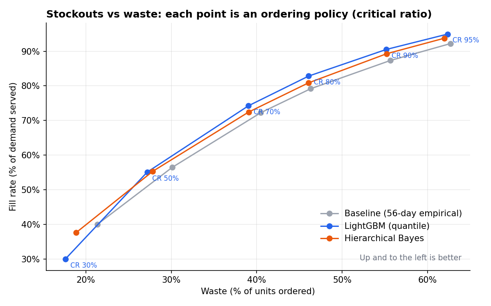
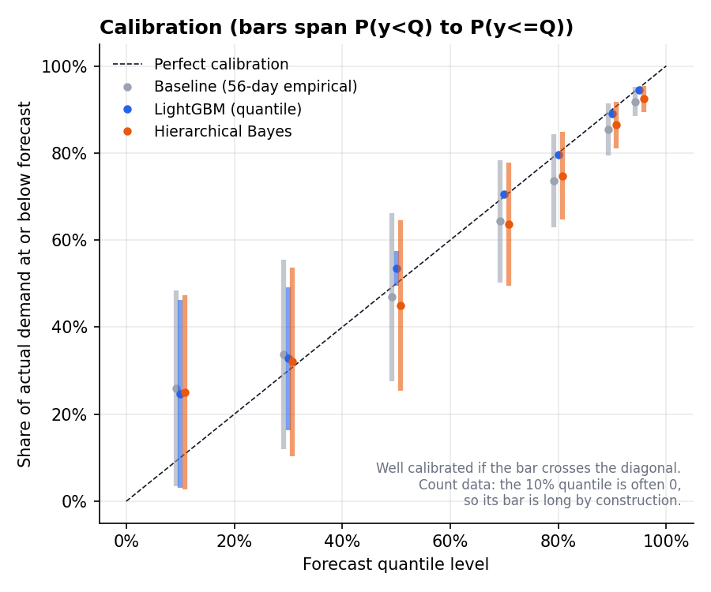
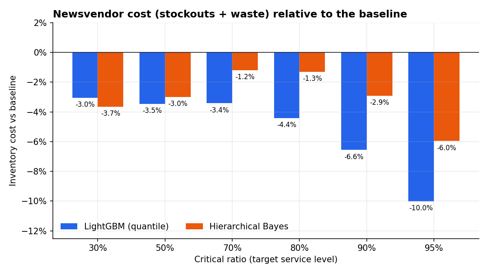
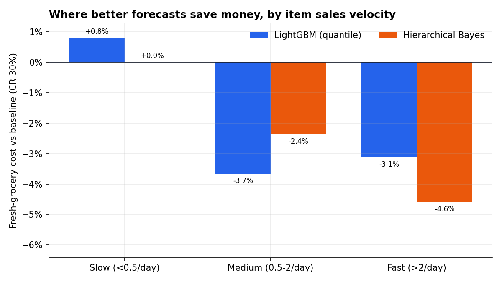
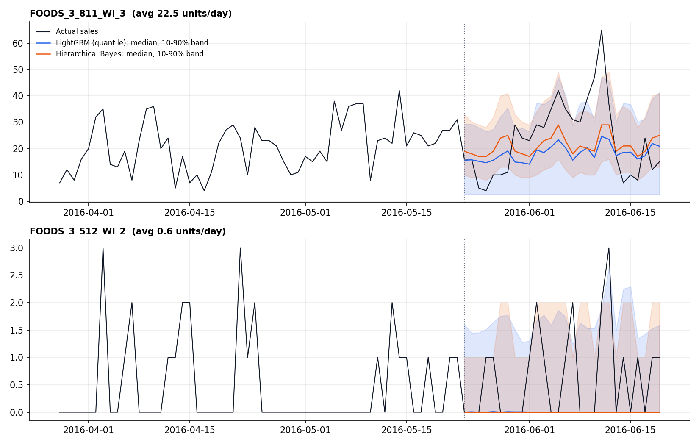

# Probabilistic Grocery Demand Forecasting and Newsvendor Ordering (M5)

Forecasting daily item-level demand for Walmart grocery items, then judging the forecasts by
what they do on the shelf: stockouts and waste, not just accuracy.

**Data:** [M5 competition](https://www.kaggle.com/competitions/m5-forecasting-accuracy), FOODS_3
department: 823 items × 10 stores (CA, TX, WI) = 8,230 daily series. Trained on Nov 2014 to
May 2016; tested on the official M5 evaluation period, 23 May to 19 June 2016 (230,440 item-store-days).
Half of all item-days have zero sales and the median item sells about one unit a day.

## What's in it

**1. Three probabilistic forecasts** (all output the same quantile grid: 10, 30, 50, 70, 80, 90, 95%)

| Model | How it works |
|---|---|
| Baseline | Empirical quantiles of each series' last 56 days of sales |
| LightGBM | Global quantile-regression model per quantile level; lag ≥ 28 features (direct 28-day horizon, no recursion), rolling means, price relative to history, weekday, events, SNAP |
| Hierarchical Bayes | Gamma–Poisson hierarchy: each item-store's demand rate is partially pooled toward item level × store level, with weekday and SNAP multipliers and negative-binomial daily noise. The pooling strength is chosen by maximising the marginal likelihood (empirical Bayes); posterior predictive is moment-matched negative binomial |

**2. Business evaluation (newsvendor).** Each forecast becomes a daily order: order the demand
quantile at the critical ratio CR = cu / (cu + co), where cu is the margin lost per unit short and
co the cost of a unit thrown away. I sweep CR from 30% to 95% and measure fill rate, stockout days,
waste and cost. At 30% grocery margin with perishable waste, the cost-optimal CR is 30%.

**3. [Write-up: how forecast errors affect stores](WRITEUP.md).**

## Results

**Accuracy** (test period, 230,440 item-store-days)

| Model | MAE (median) | Pinball loss | Scaled pinball | In-stock at q90 | In-stock at q95 |
|---|---|---|---|---|---|
| Baseline | 1.680 | 0.610 | 0.405 | 91.4% | 95.1% |
| LightGBM | **1.632** | **0.572** | **0.390** | 92.7% | 96.3% |
| Hierarchical Bayes | 1.635 | 0.583 | 0.394 | 91.8% | 95.5% |

**Business outcomes**

| | Baseline | LightGBM | Hierarchical |
|---|---|---|---|
| Waste needed for 80% fill rate | — | **−13%** | −8% |
| Waste needed for 90% fill rate | — | **−19%** | −13% |
| Cost at CR 30% (fresh economics) | — | −3.0% | **−3.7%** |
| Cost at CR 95% (high-availability economics) | — | **−10.0%** | −6.0% |
| Items out of stock per store-day, ordering the 90th percentile | 70 | **61** | 68 |



### Findings

1. **The same forecast-accuracy gain is worth much more in waste terms.** LightGBM's 6% lower
   pinball loss turns into 13–19% less waste at the same fill rate.
2. **Ordering the point forecast is expensive.** Ordering the median instead of the
   cost-optimal 30th percentile raises fresh-grocery cost by 14% (LightGBM) to 20% (baseline).
3. **The models win in different places.** The hierarchical model is best at low service levels,
   on fast movers, and in week 1 of the horizon. LightGBM is best at high service levels and in
   weeks 3–4, where price and calendar features matter more than recent history.
4. **Slow movers are an assortment problem.** A quarter of item-days come from items selling under
   0.5 a day; at fresh economics every model orders almost nothing for them and none beats the
   baseline.
5. **Calibration is good at the top.** All three models hit their in-stock targets when ordering
   the 90th and 95th percentiles; LightGBM's continuous quantiles are almost exactly calibrated
   (90% quantile covers 89.1% of days).

| | |
|---|---|
|  |  |
|  |  |

## Tableau dashboard

**Live dashboard:** *(Tableau Public link to be added)*

Three dashboards built from the results: store and state outcomes (fill rate, waste, stockouts
for any model and ordering policy), model comparison (trade-off frontier, cost vs baseline,
accuracy by horizon, calibration) and data quality (missing dates and cells, store closures,
unlisted items, zero-sales rates, demand classes).

The data extracts are in [`tableau/`](tableau/) (`m5_tableau_data.xlsx` plus CSVs), built by
`python src/tableau_extract.py`. [`tableau/BUILD_GUIDE.md`](tableau/BUILD_GUIDE.md) covers the
calculated fields, sheet layouts and check values.

## Assumptions and limitations

- **Censored demand:** M5 records sales, not demand. Stockout days look like low-demand days.
- **Single-period newsvendor:** no inventory carry-over, lead time, case packs or minimum shelf
  stock. Absolute waste is overstated for shelf-stable items; model comparisons still hold.
- **Economics:** 30% gross margin, zero salvage on waste. The CR sweep shows results for other
  cost structures (the cost at CR c uses cu = c × price, co = (1 − c) × price, which is exactly
  price-weighted pinball loss).
- **One test window** (the official M5 evaluation month). Rolling-origin backtests would firm up
  the differences, which are a few percent for some metrics.
- The hierarchical model uses empirical-Bayes hyperparameters and conjugate updates rather than
  full MCMC, so it fits 8,230 series in seconds; a PyMC version with priors on the weekday and
  price effects is a natural extension.

## Run it

```bash
pip install -r requirements.txt
./get_data.sh                 # M5 files into ./data (or download from Kaggle)
python src/prepare.py         # features            (~30 s)
python src/models.py          # all three forecasts (LightGBM ~35 min on 2 CPU cores)
python src/evaluate.py        # accuracy + newsvendor tables -> output/eval_*.csv
python src/charts.py          # figures/
python src/tableau_extract.py  # Tableau extracts -> tableau/  (~1.5 min)
```

Run a single model with `python src/models.py hier` (or `baseline`, `lgbm`).

## Files

```
src/prepare.py     load M5, filter FOODS_3, build features, train/valid/test split
src/models.py      baseline, LightGBM quantile, hierarchical Bayes
src/evaluate.py    pinball loss, calibration, newsvendor sweep, segment and store-level impact
src/charts.py      figures
src/tableau_extract.py  Tableau-ready extracts
tableau/           Tableau data (xlsx + CSV) and build guide
WRITEUP.md         how forecast errors affect stores
output/            evaluation tables (CSV), model diagnostics
figures/           charts
```
